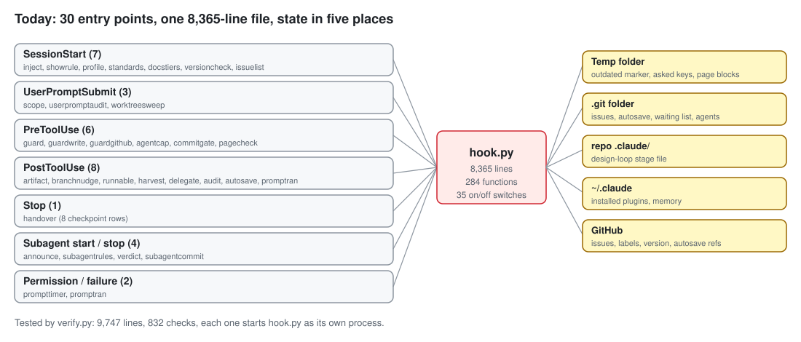
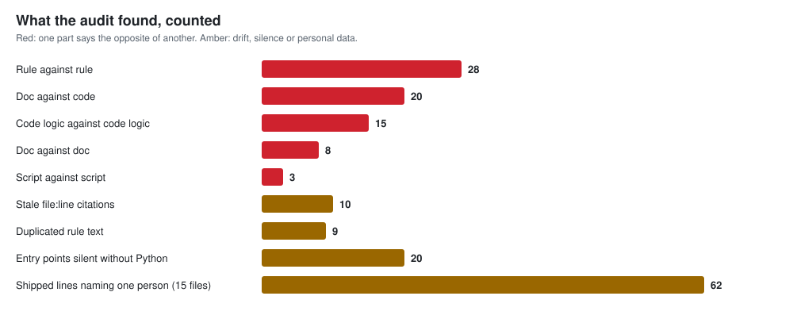
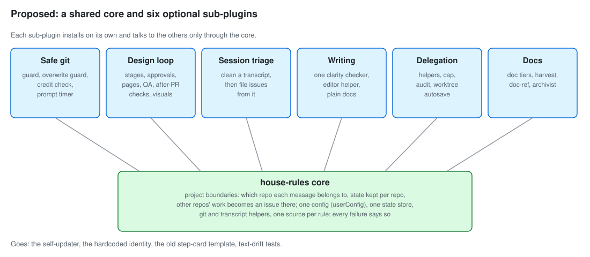

# House-rules plugin audit, 2026-10-16

This is the summary of a full read of the house-rules plugin at version 2.68.0: its rules, its
docs, `hook.py`, the test suite and the smaller scripts. It was asked for before a restructure,
so that the plugin can work for anyone, not only for aj's accounts. The raw findings, each with
`file:line` on both sides, are in five files in this folder:

| File | What it compares |
|---|---|
| [01-rules-vs-rules.md](01-rules-vs-rules.md) | Every rule file, agent, command, skill and output style against each other |
| [02-docs-vs-code.md](02-docs-vs-code.md) | `docs/` and the READMEs against `hooks.json`, `run.sh` and `hook.py` |
| [03-hook-first-half.md](03-hook-first-half.md) | `hook.py` lines 1-4200: inventory, logic against logic |
| [04-hook-second-half.md](04-hook-second-half.md) | `hook.py` lines 4200-8365: inventory, logic against logic |
| [05-tests-and-scripts.md](05-tests-and-scripts.md) | `verify.py`, `run.sh`, `clarity.py`, `make_page.py` and the other scripts |
| [06-recent-issues.md](06-recent-issues.md) | Ten recent issues (#287, #296-#304) against these recommendations, and what they change |

**Revised the same day for the recent issues.** Three recommendations below changed after reading
them (details in file 6). A 2.68.1 patch for the issue "the design loop is broken and blocks
sessions" (#303) ships before anything else. The core gains project boundaries, so it knows which
repo each message belongs to, from the issues "a session finishes its own task" (#301) and
"approvals are dropped silently when the session folder isn't a git repo" (#296). And a sixth
sub-plugin, Session triage, cleans transcripts of secrets before they are shared, from the issue
"a two-helper tool that cleans a session transcript, then files issues from it" (#304). The
suggested core identity is now aj's own goal from that issue: safe work on several projects at
once. The published page carries the revised version.

The diagrams in `diagrams/` are drawn by `make_diagrams.py` from the counts below.

## What the plugin is today

- One file, `scripts/hook.py`, holds 8,365 lines and 284 functions, with 30 entry points wired to 9 Claude Code hook events.
- 35 `HOUSE_RULES_*` switches turn parts on and off. Four entry points have no switch at all: inject, profile, standards and guard.
- State lives in five places: the temp folder, the repo's `.git` folder, the repo's `.claude/` folder, `~/.claude`, and GitHub.
- `scripts/verify.py` is one 9,747-line script with 832 checks (559 call sites in 123 sections). Every behaviour check starts `hook.py` as its own process, so nothing tests a single function. 214 of its lines check that copies of text haven't drifted apart.
- 62 lines in 15 shipped files name one person, repo or label: Ajw2003, AjsAgent, "AJ's agent", aj's noreply email, `C:\Users\aj`, Focus Deck, PlunderSpell, RockSkipping, aj-house-rules. `verify.py` pins more.

## What the audit found

### The contradictions that matter most
1. **The plugin breaks its own credit rule.** Autosave commits carry "Co-Authored-By: Claude" and sign as `house-rules@localhost` (`hook.py:4896-4915`), while the guard refuses both on any other commit (`hook.py:5979`, `5983`, `6100-6101`). Autosave escapes because it runs git itself.
2. **"Nothing fails silently" is broken in 34 places.** Without Python, 20 of 30 entry points exit with no message (`run.sh:106-156`). The guard lets an empty payload through although it is documented as failing closed (`hook.py:2406-2408`). Errors are swallowed at 13 more sites: 10 in `hook.py` and 3 in `plain_docs_check.py` and the clarity loader (listed in findings files 3, 4 and 5).
3. **Only the user moves the design-loop stage, except when the code does.** The comment says so (`hook.py:5226`), but opening a pull request, label changes and an edit attempt all move it (`5857`, `5425-5430`, `5670-5671`).
4. **Five end-of-reply checks judge only the newest message:** card, plain summary, writing, long reply and choices (`hook.py:6764`, `7696`, `7747`, `7746`, `7360`). That is how a shorter retry got past the page check in this session.
5. **The two writing checkers disagree.** `clarity.py` strips code before looking for jargon; `plain_docs_check.py:254` doesn't. Neither can see a defined or quoted term, so a reply that explained "handler" was flagged, and then so was the reply reporting the flag (`clarity.py:195-197`).
6. **The rules contradict each other in 28 places.** Examples: deletes are allowed because git can restore them (`destructive-action.md:20-21`), and refused for the same reason (`edit-place.md:8-9`); test suites run twice (`green-suite.md:16-17`) and exactly once (`agents/builder.md:13`); pages are never published unasked (`handover-command.md:162-163`) and are required on every long reply (`show-dont-tell.md:18-19`).
7. **The docs describe a plugin that no longer exists in 20 places.** Examples: 19 handlers instead of 30, a 200-word threshold instead of 160, prompts that 2.68.0 removed, a table listing 15 of 30 entry points, and four different test counts, none of them 832.
8. **The version notice states a guess as fact.** It says the old version is still running (`hook.py:1452`). The Claude Code docs say hooks keep the old path until `/reload-plugins`; this session's hooks ran the new path anyway.

### Root causes
- **One file does everything,** so every feature shares helpers, state files and the end-of-reply check, and one change ripples into the others.
- **Each rule lives in several copies** (summary, detail file, output style, agent text, docs, code messages), so the copies drift, and the tests spend 214 lines checking drift.
- **Identity is written into the code,** not read from configuration, so the plugin works for one person only.
- **The plugin rebuilt things Claude Code now provides:** a self-updater, a state location, a way to configure per-user values, and a way for one plugin to depend on another.

## Recommendations

### What Claude Code already provides (checked against its docs on 2026-10-16)
| Built-in | What it replaces here |
|---|---|
| `dependencies` in `plugin.json`, installed automatically | Shipping every feature in one plugin |
| `userConfig` options, set with `/plugin configure`, read by hooks as `CLAUDE_PLUGIN_OPTION_<KEY>` | Hardcoded name, credit, email, labels and owner |
| Marketplace `autoUpdate`, plus `/reload-plugins` for a running session | `event_versioncheck` and its self-update (`hook.py:1471-1633`) |
| `CLAUDE_PLUGIN_DATA` (`~/.claude/plugins/data/<id>/`), kept across updates | Temp-folder and `.git` state files for plugin-wide state |

### Keep, change, drop, replace
Every current part is listed against where it is today.

| Part (today's location) | Verdict | Why |
|---|---|---|
| Rule injection: inject, showrule (`hook.py:584-678`) | **Change** | Keep the mechanism. Load each rule from one source file per rule, so no copy can drift. |
| Machine profile, standards (`hook.py:690-996`) | **Keep**, move to core | Works and is generic; remove the Windows and Unity assumptions from the rule text. |
| Doc tiers check (`hook.py:1062-1158`) | **Change**, move to Docs | Owner comes from config, not `DEFAULT_GITHUB_OWNER = "Ajw2003"`. |
| Version check and self-update (`hook.py:1471-1633`) | **Replace** | Marketplace `autoUpdate` and `/reload-plugins`. The notice becomes a plain "a newer version is installed; run /reload-plugins". |
| Destructive and branch guard (`hook.py:2394-2636`) | **Keep**, split | Into a Safe-git sub-plugin; split the 243-line function; empty payload must refuse. |
| Overwrite guard (`hook.py:2790-2852`) | **Keep** | Fix the docstring that says it asks. |
| Credit, author and branch checks (`hook.py:5971-6186`), guardgithub (`6031-6094`) | **Change** | Read the name, credit line and branch prefix from config; apply the same identity to autosave. |
| Prompt timer and waiting list (`hook.py:4209-4576`) | **Keep**, move to Safe git | Independent already. |
| Design loop (`hook.py:5224-5695`) | **Change** | Its own sub-plugin; write down every automatic stage move, or remove them. |
| Issue workflow (`hook.py:4925-5222`, `5713-5931`, `6254-6341`) | **Change** | Into Design loop; one issue count, not two; labels from config. |
| End-of-reply checks, `event_handover` (`hook.py:7592-7865`) | **Change** | Each check judges the whole turn, not the newest message; each sub-plugin registers its own checks; delete the dead page-saved rows (`7485`, `7519-7520`). |
| Page check and page builder (`hook.py:7431-7481`, `make_page.py`) | **Keep**, move to Design loop | |
| Old step-card template (`templates/step-card.html`) | **Drop** | Superseded by `make_page.py`; it holds a `C:\Users\aj` path and contradicts the page rule. |
| Writing checks (`clarity.py`, `plain_docs_check.py`, writing rows in handover) | **Change** | One checker, used everywhere; recognise defined and quoted terms. |
| Helpers: agents, agentcap, announce, verdict, audit (`hook.py:3212-4065`, `6550-6696`) | **Keep**, move to Delegation | Fix the builder's "run once" and the archivist's missing tools line. |
| Worktree autosave, commitgate, worktreesweep, subagentcommit (`hook.py:4642-4924`, `6344-6544`) | **Change** | Same identity rules as every other commit; the force-push to a snapshot ref is a question for the grilling session. |
| Harvest, docref, archivist, project-docs, plain-docs | **Keep**, move to Docs | Harvest is already independent (`hook.py:7868-8283`). |
| Scope, artifact, runnable, branchnudge, delegate reminders | **Keep**, sort into the sub-plugin each serves | |
| `run.sh` | **Change** | Every entry point gets a no-Python message, generated from the hook list. |
| `verify.py` (832 checks) | **Replace** | Unit tests per module for pure logic, a small end-to-end set per hook event, and no drift tests once each rule has one source. The test count is a result, not a goal. |
| Rule text: 28 contradictions, 9 duplicates | **Change** | Each contradiction becomes one decision in the grilling session; then one source per rule. |
| Docs: 20 doc-code and 8 doc-doc disagreements, 10 stale citations | **Change** | Regenerate the hook table from `hooks.json`; fix or remove every stale citation. |
| The account-wide re-inject marker (the last build plan) | **Drop** | It needs a shared store that a stranger's install can't have. `/reload-plugins` does the job per session. |

## What the grilling session needs to settle
1. **The core identity.** Is this plugin "guardrails for Claude Code", "a workflow for designing before building", or "a writing standard"? The answer decides which sub-plugin is the default install.
2. **The 28 rule contradictions.** Each needs a single answer, starting with deletes, asking versus refusing, and how many test runs.
3. **Which rules are personal preferences** rather than safety, and so become options instead of hard blocks.
4. **The design loop's automatic stage moves:** keep them as documented behaviour, or remove them.
5. **Worktree autosave's force-pushes:** keep, change or drop.
6. **Mid-session updates:** this session's hooks ran the new version without `/reload-plugins`, against the docs. Test it on your desktop before relying on either behaviour.

## How this audit was done
Five read-only scout passes over the files above, each told to quote both sides with `file:line`.
I spot-checked 14 of their claims against the code and all held; one claim was withdrawn
(`rules/environment.md` is missing on purpose, because it is machine-local). I ran the test suite
(832 passed) and counted the test sections, switches, state files and personal values with
scripts. Claude Code's built-in features were checked by a guide helper against the official
plugin docs (manifest reference, dependencies, loading, install and CLI reference pages).

Several checks misfired while I was doing this, and they are findings too. The parity check fired
three times on turns that only wrote these notes. The writing check flagged a word it had just
been told was defined. And the design-loop gate refused a screenshot script in my scratch folder
while I was taking screenshots for this report.
